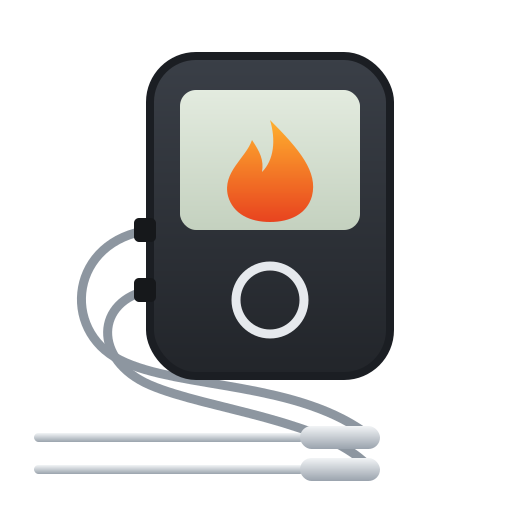

# Sonoff BMT01 BBQ Thermometer for Home Assistant

A Home Assistant custom integration for the **SONOFF BMT01** Bluetooth BBQ meat thermometer. It connects directly over Bluetooth (local adapter or ESPHome Bluetooth proxy), with no cloud and no eWeLink app needed after setup.

> **Unofficial.** Sonoff does not publish the BMT01 protocol. This integration is based on community reverse engineering and is not affiliated with or supported by SONOFF / ITEAD.

## Features

- Live temperature for all **4 probes**, pushed by the thermometer about **every 2 seconds**
- Per-probe **status** (`ok`, `not_connected`, `too_high`, `too_low`, `invalid`)
- **Battery** level
- **Connected** status, so you can alert when the thermometer drops off
- Works through **ESPHome Bluetooth proxies**, giving whole-house range
- Automatic reconnect when the thermometer is switched back on

## Requirements

- Home Assistant **2025.2** or newer (the integration icon shows from **2026.3**)
- A **connectable** Bluetooth path to the thermometer, either:
  - an ESPHome Bluetooth proxy in **active** mode (recommended), or
  - a Bluetooth adapter on the Home Assistant host
- The thermometer **paired once in the eWeLink app**. This is only to obtain its key; see below.
- The **eWeLink app closed** while Home Assistant is connected. The BMT01 accepts only one connection at a time.

ESPHome proxy configuration:

```yaml
esp32_ble_tracker:
  scan_parameters:
    active: true

bluetooth_proxy:
  active: true
```

## Step 1: Get the eWeLink key

The thermometer only sends data after a challenge-response handshake encrypted with your **eWeLink account `apikey`**. No phone root is needed. The easiest way to get it is through [AlexxIT SonoffLAN](https://github.com/AlexxIT/SonoffLAN), which caches your eWeLink device list on your Home Assistant server.

1. Install **Sonoff LAN** from HACS, restart, then add the **Sonoff** integration. Log in with the eWeLink account the BMT01 is paired to.
2. Open the **Terminal & SSH** app (add-on) and run:

   ```bash
   jq '.. | objects | select((.productModel? // "") == "BMT01" or ((.name? // "") | test("bmt|thermo|bbq";"i"))) | {name, deviceid, productModel, apikey, devicekey}' /config/.storage/sonoff/*.json
   ```

3. Note the `apikey` (UUID format) and the `deviceid`. If `apikey` is rejected, try `devicekey`.
4. You can remove SonoffLAN afterwards if you don't otherwise use it.

> Treat the key like a password: it belongs to your eWeLink account.

> The `mac` / `apmac` values in the eWeLink data are **not** the Bluetooth address. The config flow finds the right one for you.

## Step 2: Install

### HACS (custom repository)

1. HACS → ⋮ → **Custom repositories**
2. Add `https://github.com/Datortarp5/sonoff-bmt01`, category **Integration**
3. Download **Sonoff BMT01 BBQ Thermometer**, then restart Home Assistant

### Manual

Copy `custom_components/sonoff_bmt01` into `/config/custom_components/`, then restart Home Assistant.

## Step 3: Add the thermometer

1. Switch the BMT01 on and **close the eWeLink app**.
2. **Settings → Devices & services → Add integration → Sonoff BMT01 BBQ Thermometer**.
3. **Bluetooth address**: pick the device named `ck_<deviceid>` from the list, or type the address shown for it under *Settings → Devices & services → Bluetooth → Advertisement monitor*.
4. **eWeLink key**: paste the `apikey`.

Within a few seconds the **Connected** sensor turns on and the probes start reporting.

## Entities

One device, **BMT01**, with the entities below (entity IDs are the defaults).

| Entity | Example ID | Unit | Updates | Notes |
|---|---|---|---|---|
| Probe 1–4 | `sensor.bmt01_probe_1` | °C | ~every 2 s | Unavailable unless that probe reports a temperature |
| Probe 1–4 status | `sensor.bmt01_probe_1_status` | – | ~every 2 s | See the status values below |
| Battery | `sensor.bmt01_battery` | % | on connect, then every 30 min | Diagnostic; keeps its last value while the thermometer is off |
| Connected | `binary_sensor.bmt01_connected` | – | on change | Diagnostic; on while HA holds the Bluetooth link |

### Probe status values

The status values are passed through exactly as the thermometer reports them:

| Status | Meaning |
|---|---|
| `ok` | Probe connected; its temperature is in the Probe sensor |
| `not_connected` | No probe plugged into that socket |
| `too_high` | Above the measurable range (shown as `HHH` on the display) |
| `too_low` | Below the measurable range, e.g. a probe in a freezer |
| `invalid` | The thermometer reported an invalid reading |

### Timings

| What | Interval |
|---|---|
| Probe temperatures | Pushed by the thermometer about every 2 s, no polling |
| Battery | First read about 2 s after connecting, then every 30 min (retries every 60 s on failure) |
| Reconnect | After 5 s, 10 s, 30 s, then every 60 s while the thermometer is off or out of range |

## Good to know

- **One connection only.** While Home Assistant is connected, the eWeLink app can't connect, and vice versa. If you open the app, Home Assistant reconnects once the app lets go.
- **Proxy slot.** The thermometer holds one of the proxy's connection slots (an ESPHome proxy has 3 by default) for as long as it's on.
- **Battery.** A permanent connection uses more power than occasional app use. Switch the thermometer off when you're not cooking.
- **Temperatures are whole °C**, which is the thermometer's resolution. Display °F by changing the entity's unit in Home Assistant; the device's own unit setting isn't used.
- **Cooking alerts.** Build target-temperature alerts in Home Assistant automations or Node-RED using the Probe sensors. The thermometer's built-in alarm settings aren't supported.

## Not supported (yet)

Setting the on-device alarms, temperature unit and calibration, and reading on-device history. The protocol for these is partly known but not reliable enough yet.

## Troubleshooting

Enable debug logging on the integration card (⋮ → **Enable debug logging**), reproduce the problem, then disable it to download the log.

| Log message | Fix |
|---|---|
| `not in range of any connectable adapter or proxy` | Thermometer off or out of range, or the proxy isn't in active mode |
| `authentication timed out` | The eWeLink app is still connected; close it |
| `the key is wrong` | Use the other key (`apikey` ↔ `devicekey`) |

## Credits

Built on the reverse-engineering work in the Home Assistant Community threads [Sonoff BMT01](https://community.home-assistant.io/t/sonoff-bmt01/799673) and [Sonoff BMT01 – second try](https://community.home-assistant.io/t/sonoff-bmt01-second-try/1009262). Thanks especially to **plans-coding** (authentication and protocol from the eWeLink app), **Greywood** (command tickets and the apikey discovery), and **dennyreiter** (first GATT mapping).

## License

MIT, see [LICENSE](LICENSE).
